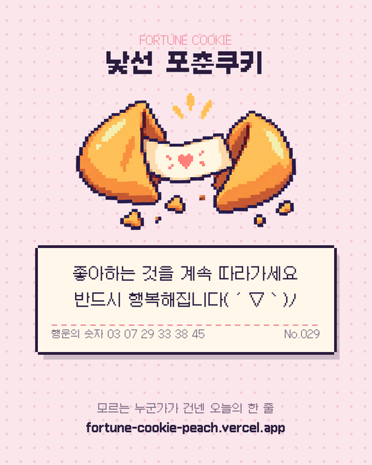
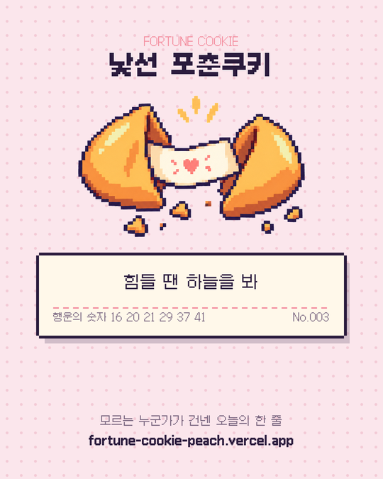
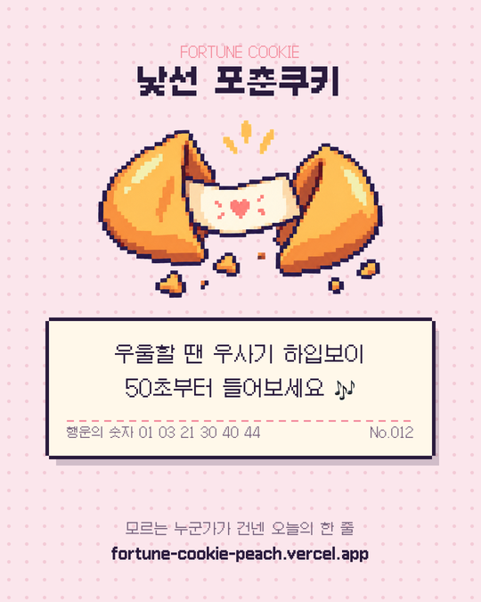
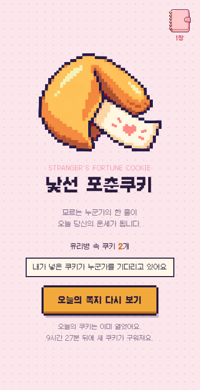
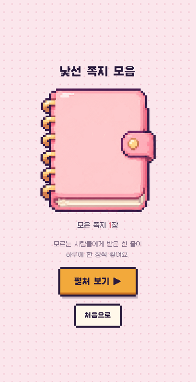
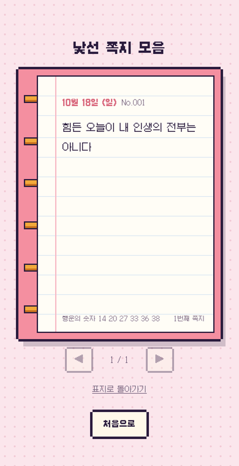
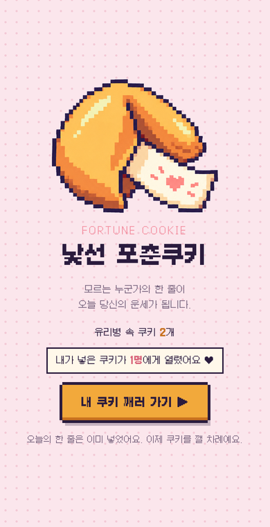
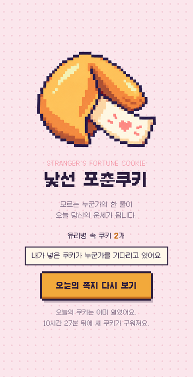
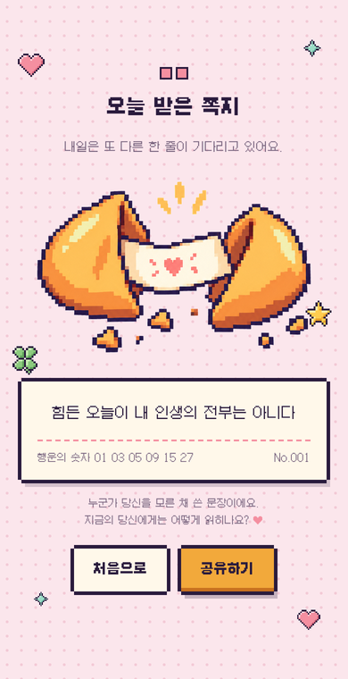

# 🥠 낯선 포춘쿠키

> 모르는 누군가의 한 줄이, 오늘 당신의 운세가 됩니다.

**인터랙티브 미디어 창작 · 우연놀이(알레아) 참여 작품**

관객은 모르는 다음 사람에게 건넬 한 줄을 쿠키에 넣고, 유리병에서 다른 누군가가 넣은 한 줄을 무작위로 꺼내 깨 봅니다. 누가 썼는지는 끝까지 알 수 없습니다.

🔗 **https://fortune-cookie-peach.vercel.app**

<table align="center">
  <tr>
    <td align="center"><br><sub>1. 시작</sub></td>
    <td align="center"><br><sub>2. 한 줄 쓰기</sub></td>
    <td align="center"><br><sub>3. 유리병에 쏙</sub></td>
  </tr>
  <tr>
    <td align="center"><br><sub>4. 쿠키 깨기</sub></td>
    <td align="center"><br><sub>5. 쪽지</sub></td>
    <td align="center"><br><sub>깰 쿠키가 없을 때</sub></td>
  </tr>
</table>

---

## 작품 의도

우리는 보통 운세를 정해진 문구나 보이지 않는 신비한 존재에게서 받는다고 생각한다. 하지만 이 놀이에서 운세를 쓰는 사람은 나와 같은 공간을 지나간 익명의 타인이다. 그 사람은 나를 모른 채 한 줄을 썼고, 나는 그 사람을 모른 채 그 한 줄을 받는다.

관객은 다른 사람을 위해 한 줄을 남기는 '쓰는 사람'이 되었다가, 누군가 남긴 한 줄을 받는 '읽는 사람'이 된다. 같은 문장이라도 그것을 꺼낸 사람의 그날 상황에 따라 위로가 되기도 하고 경고가 되기도 한다. 문장의 의미는 쓴 사람이 아니라 우연히 받은 사람의 하루에서 완성된다.

이를 통해 우연은 하늘에서 떨어지는 것이 아니라, 서로 모르는 사람들 사이를 오가며 만들어진다는 것을 표현하고자 했다. 관객이 가져가는 띠지 한 장은 낯선 누군가가 건넨 작은 응원으로 남는다.

## 놀이 방법

| 단계 | 화면 | 하는 일 |
|---|---|---|
| 1 | 시작 | 통통 튀는 포춘쿠키를 보고 **시작하기**를 누릅니다. |
| 2 | 한 줄 쓰기 | 모르는 다음 사람에게 건넬 한 줄(최대 100자)을 적고 **쿠키에 넣기**를 누릅니다. |
| 3 | 유리병 | 내 쿠키가 유리병에 쏙 떨어지며 다른 사람들의 쿠키와 섞입니다. (자동으로 넘어감) |
| 4 | 쿠키 깨기 | 쿠키를 **세 번 톡톡** 두드립니다. 두드릴 때마다 흔들리며 금이 갑니다. |
| 5 | 쪽지 | 쿠키가 갈라지며 다른 사람의 한 줄이 담긴 쪽지가 나옵니다. |

> 유리병에 내 쿠키밖에 없으면 3단계 다음에 **"아직 깰 포춘쿠키가 없어요"** 화면이 나옵니다.
> **돌아가기**로 시작 화면에 가거나, 다른 사람이 쿠키를 넣은 뒤 **다시 확인하기**를 누르면 바로 깨기 화면으로 넘어갑니다.

### 규칙

1. 따뜻하고 긍정적인 말만 적어요.
2. 모르는 사람에게 건넬 한 줄을 적어요.
3. 내가 쓴 쿠키는 나에게 돌아오지 않아요.
4. 한 줄 넣기와 쿠키 깨기는 **하루에 한 번**씩만 할 수 있어요. (한국 시간 자정에 초기화)

## 주요 기능

### 참여

| 기능 | 설명 |
|---|---|
| **하루 한 번** | 한국 시간 자정 기준으로 하루에 한 줄 넣기, 쿠키 하나 깨기만 할 수 있어요. |
| **상황별 시작 화면** | 한 줄만 넣었으면 **내 쿠키 깨러 가기**, 다 했으면 남은 시간과 **오늘의 쪽지 다시 보기**가 나와요. |
| **내 쿠키 소식** | 시작 화면에 "내가 넣은 쿠키가 N명에게 열렸어요"가 표시돼요. |

### 뽑기

| 기능 | 설명 |
|---|---|
| **공용 유리병** | 모든 사람의 쿠키가 하나의 유리병에 모이고, 시작 화면에 쿠키 수가 보여요. |
| **내 쿠키 제외** | 내가 넣은 한 줄은 나에게 뽑히지 않아요. ([사용자 구분 방식](#사용자-구분-방식) 참고) |
| **중복 줄이기** | 아직 받지 않은 쪽지를 먼저 뽑아요. |
| **미리 확인** | 깰 쿠키가 없으면 깨기 전에 안내 화면을 보여줘요. |

### 쪽지

| 기능 | 설명 |
|---|---|
| **낯선 쪽지 모음** | 내가 연 쪽지가 하루에 한 장씩 수첩에 쌓여요. 시작 화면 오른쪽 위 수첩 아이콘(모은 장수 배지)을 누르면 표지가 나오고, 펼쳐서 한 장씩 넘겨 볼 수 있어요. 서버에 방문자별로 저장돼요. |
| **쪽지 정보** | 받은 한 줄과 함께 행운의 숫자 6개(1~45, 깰 때마다 새로 뽑음)와 쿠키 번호(No.001)가 찍혀요. |

### 연출

| 기능 | 설명 |
|---|---|
| **픽셀 연출** | 쿠키 흔들림, 부스러기, 깨질 때 터지는 하트·별·클로버·반짝이 아이콘 |
| **진동** | 쿠키를 두드리고 깰 때 진동이 와요. (안드로이드 지원, 아이폰 웹은 미지원) |

### 공유

| 기능 | 설명 |
|---|---|
| **공유 카드** | 받은 쪽지를 픽셀 카드 이미지(1080×1350)로 만들어 카카오톡·인스타그램 등으로 보내요. 공유 창이 없으면 문구를 복사해요. |
| **링크 미리보기** | 링크를 공유하면 OG 이미지 카드가 표시돼요. |

<table width="100%">
  <tr>
    <td width="33%" align="center"></td>
    <td width="33%" align="center"></td>
    <td width="33%" align="center"></td>
  </tr>
</table>

### 기타

| 기능 | 설명 |
|---|---|
| **공용 기기 모드** | 주소 끝에 `#shared`를 붙이면 한 기기를 돌려 쓸 수 있어요. 방금 넣은 한 줄만 제외되고 하루 제한이 없어요. |
| **접근성** | 키보드 조작, 포커스 표시, 움직임 줄이기(`prefers-reduced-motion`)를 지원해요. |


## 사용자 구분 방식

로그인 없이 **브라우저마다 무작위 방문자 ID**로 구분합니다.

1. 처음 접속하면 무작위 문자열(예: `k3f9x…`)을 만들어 브라우저의 `localStorage`에 저장합니다.
2. 쿠키를 넣을 때 문장과 함께 이 ID를 저장합니다.
3. 쿠키를 깰 때 서버가 같은 ID로 넣은 쿠키를 모두 제외하고 무작위로 하나를 고릅니다.

이 ID는 이름이나 기기 정보와 연결되지 않으므로, 누가 썼는지는 알 수 없습니다.
단, 다른 브라우저나 시크릿 창으로 열거나 사이트 데이터를 지우면 새 방문자로 인식됩니다.

## 기술 스택

| 구분 | 사용 |
|---|---|
| 화면 | HTML · CSS · Vanilla JavaScript (빌드 도구 없음) |
| 서버 | Vercel Serverless Function (`api/cookies.js`) |
| 저장소 | Upstash Redis (Vercel Marketplace, 무료 플랜) |
| 폰트 | [Galmuri11](https://github.com/quiple/galmuri) (픽셀 한글 폰트, SIL OFL 1.1) |

## 폴더 구조

```
fortune-cookie/
├── index.html              # 화면 전체 (시작 → 쓰기 → 유리병 → 깨기 / 깰 쿠키 없음)
├── api/
│   └── cookies.js          # 쿠키 저장 · 개수 · 무작위 뽑기 API
├── assets/
│   ├── cookie.png          # 포춘쿠키 픽셀 이미지
│   ├── cookie-broken.png   # 깨진 포춘쿠키 이미지
│   ├── jar.png             # 쿠키 유리병 이미지
│   ├── book.png            # 낯선 쪽지 모음 수첩 표지
│   ├── book-icon.png       # 시작 화면 수첩 아이콘
│   ├── icon-*.png          # 장식 아이콘 (하트 · 별 · 클로버 · 반짝이)
│   ├── favicon*.png        # 파비콘 · 홈 화면 아이콘
│   ├── og.png              # 링크 미리보기 이미지 (1200×630)
│   ├── Galmuri11*.woff2    # 픽셀 폰트
│   └── Galmuri-OFL.md      # 폰트 라이선스
├── docs/                   # README 스크린샷
└── package.json
```

## API

모든 요청은 `/api/cookies`로 보냅니다.

| 메서드 | 요청 | 응답 | 설명 |
|---|---|---|---|
| `GET` | — | `{ count }` | 유리병 속 쿠키 수 |
| `POST` | `{ text, v, shared }` | `{ id, count }` | 한 줄 넣기 (`text` 2~100자, `v` 방문자 ID, 하루 한 번) |
| `POST` | `{ open, v, shared, lucky }` | `{ ok, opens }` | 쿠키 열기 기록 (`open` 쿠키 ID, 하루 한 번, 열린 횟수 +1, 낯선 쪽지 모음에 저장) |
| `GET` | `?book=1&v=…` | `{ items }` | 낯선 쪽지 모음 (내가 연 쪽지 목록) |
| `GET` | `?me=1&v=…` | `{ mine, opened, putToday, openedToday }` | 내 쿠키 소식과 오늘 참여 여부 |
| `GET` | `?draw=1&v=…&exclude=…&seen=…&shared=0` | `{ id, text, no, count }` 또는 `{ empty: true }` | 무작위로 하나 꺼내기 |

- `exclude`: 방금 넣은 쿠키 ID
- `seen`: 이미 받은 쿠키 ID 목록 (쉼표 구분, 최근 50개)
- `shared=1`: 공용 기기 모드 (방문자 ID로 제외하지 않음)
- 오류: `400 too_short`, `409 jar_full`(최대 5,000개), `429 already_put` · `already_opened`(오늘 이미 참여), `503 storage_not_configured`

## 데이터베이스 설정

쿠키는 **Upstash Redis**에 저장됩니다. Redis는 데이터를 빠르게 저장하고 꺼내는 데이터베이스로, 이 작품에서는 모두가 함께 쓰는 **"유리병"** 역할을 합니다. 화면은 각자의 기기에서 따로 열리기 때문에, 쿠키를 모아 둘 공동 보관함이 서버에 따로 필요합니다.

| 항목 | 값 |
|---|---|
| 서비스 | Upstash for Redis (Vercel Marketplace) |
| 플랜 | Free (월 500,000 명령) |
| 리전 | `iad1` Washington, D.C. (Vercel 함수와 같은 리전) |
| 연결 프로젝트 | `fortune-cookie` (Production, Preview) |
| 환경변수 접두사 | `KV` → `KV_REST_API_URL`, `KV_REST_API_TOKEN` 등 |
| 저장 키 | `fortune:cookies` (쿠키 목록), `fortune:opens` (쿠키별 열린 횟수), `fortune:book:방문자ID` (낯선 쪽지 모음), `fortune:put:날짜` · `fortune:open:날짜` (그날 참여한 방문자, 이틀 뒤 자동 삭제) |

연결 방법은 다음과 같습니다.

1. Vercel 프로젝트 → **Storage** → **Create Database** → **Upstash for Redis** 선택
2. 플랜은 **Free**, 연결할 프로젝트는 `fortune-cookie` 선택
3. **Custom Prefix**에 `KV` 입력 (코드가 `KV_REST_API_URL`, `KV_REST_API_TOKEN`을 읽습니다)
4. 연결 후 **다시 배포** (환경변수는 새 배포부터 적용됩니다)

## 트러블슈팅

### 1. 넣은 쿠키가 다음 날 0개로 보이는 문제 (2026.10.14)

**증상**: 휴대폰으로 쿠키를 넣었는데, 다음 날 다시 열면 유리병 속 쿠키가 0개로 표시됐습니다.

**원인**: Vercel 프로젝트에 데이터베이스가 연결되지 않아 `/api/cookies`가 `503 storage_not_configured`를 돌려주고 있었습니다. 이때 화면은 멈추지 않도록 **로컬 모드**로 동작하는데, 로컬 모드의 쿠키는 그 기기의 브라우저 메모리에만 잠깐 담기기 때문에 새로고침하면 사라지고 다른 사람과도 공유되지 않습니다.

**해결**: Upstash Redis(Free)를 만들어 프로젝트에 연결하고(접두사 `KV`), 다시 배포했습니다. 이후 `/api/cookies`가 `{"count":0}`을 돌려주며 정상 동작합니다.

**확인 방법**: 브라우저에서 `https://fortune-cookie-peach.vercel.app/api/cookies`를 엽니다.

| 응답 | 의미 |
|---|---|
| `{"count":숫자}` | 정상. 쿠키가 서버에 저장됩니다. |
| `{"error":"storage_not_configured"}` | 데이터베이스가 연결되지 않았거나, 연결 후 다시 배포하지 않았습니다. |

### 2. 카카오톡 링크 미리보기가 바뀌지 않는 문제 (2026.10.14)

카카오톡은 한 번 본 링크의 미리보기를 저장해 둡니다. 주소 끝에 `?v=2`처럼 새 값을 붙여 공유하거나, [카카오 공유 디버거](https://developers.kakao.com/tool/debugger/sharing)에서 캐시를 초기화합니다.

### 3. 수첩을 다녀오면 쿠키가 멈추고 표지가 흐려지는 문제 (2026.10.18)

**증상**: 휴대폰에서 낯선 쪽지 모음을 열었다가 `처음으로`를 누르면 시작 화면의 포춘쿠키가 더 이상 둥실거리지 않았습니다. 수첩을 펼쳤다가 `표지로 돌아가기`를 누르면 표지가 반투명한 것처럼 연하게 보였습니다.

**원인**: 화면이 나타날 때 쓰는 페이드인 효과(`.enter`)가 끝난 뒤에도 클래스가 그대로 남아 있었습니다. 모바일 브라우저(특히 iOS Safari)는 이런 상태로 요소를 숨겼다가 다시 보이면 안쪽의 반복 애니메이션이 멈추거나 투명도가 중간값에 머무는 경우가 있습니다. 또 터치 기기에서는 한 번 탭한 요소에 `:hover` 효과가 계속 남습니다. 데스크톱 크롬에서는 재현되지 않았습니다.

**해결**
- 페이드인 효과는 끝나면(`animationend`) 클래스를 바로 지웁니다.
- 화면을 보일 때마다 쿠키의 반복 애니메이션(`.bob`)을 처음부터 다시 시작합니다.
- 표지와 펼친 수첩을 오갈 때도 페이드인을 매번 새로 시작해서 흐린 상태로 남지 않게 합니다.
- `:hover` 효과는 마우스가 있는 기기(`@media (hover:hover)`)에서만 적용합니다.


## 업데이트 기록

### 2026.10.18 · 낯선 쪽지 모음

- **낯선 쪽지 모음**: 내가 연 쪽지를 하루에 한 장씩 모아 두는 수첩이 생겼습니다.
- **시작 화면 아이콘**: 오른쪽 위 분홍 수첩 아이콘에 모은 장수가 배지로 표시됩니다.
- **표지와 펼친 수첩**: 아이콘을 누르면 수첩 표지가 나오고, 펼치면 줄 노트 종이에 날짜, 쪽지 번호, 받은 한 줄, 그날의 행운의 숫자가 적혀 있습니다. ◀ ▶ 버튼, 좌우로 밀기, 키보드 화살표로 한 장씩 넘길 수 있습니다.
- **서버 저장**: 쪽지 모음은 서버에 방문자별로 저장되어 새로고침해도 사라지지 않습니다. (`#shared` 시연 모드에서는 저장하지 않음)
- **시작 화면 정리**: 요소 사이 간격을 넓혀 덜 답답하게 바꿨습니다.

<table align="center">
  <tr>
    <td align="center"><br><sub>시작 화면 수첩 아이콘</sub></td>
    <td align="center"><br><sub>표지</sub></td>
    <td align="center"><br><sub>펼친 수첩</sub></td>
  </tr>
</table>

### 2026.10.18 · 하루 한 번 & 내 쿠키 소식

- **하루 한 번 참여**: 한국 시간 자정을 기준으로 하루에 한 줄 넣기, 쿠키 하나 깨기만 할 수 있습니다. 브라우저와 서버 양쪽에서 확인해 주소로 직접 요청해도 우회할 수 없습니다.
- **상황별 시작 화면**: 한 줄만 넣고 아직 못 깼으면 **내 쿠키 깨러 가기**, 오늘 다 했으면 다음 쿠키까지 남은 시간과 **오늘의 쪽지 다시 보기**가 나옵니다.
- **내 쿠키 소식**: 누군가 내 쿠키를 깨면 시작 화면에 "내가 넣은 쿠키가 N명에게 열렸어요"가 표시됩니다. 아직 아무도 열지 않았으면 "내가 넣은 쿠키가 누군가를 기다리고 있어요"가 보입니다.
- **시연 모드 유지**: 주소 끝에 `#shared`를 붙인 공용 기기 모드에서는 하루 제한이 적용되지 않습니다.

<table align="center">
  <tr>
    <td align="center"><br><sub>한 줄만 넣고 아직 못 깼을 때</sub></td>
    <td align="center"><br><sub>오늘 다 했을 때</sub></td>
    <td align="center"><br><sub>오늘의 쪽지 다시 보기</sub></td>
  </tr>
</table>

## 만든 사람

**홍한희** ([@HHHv-v](https://github.com/HHHv-v))
경북대학교 컴퓨터학부 · 디지털아트융합전공
